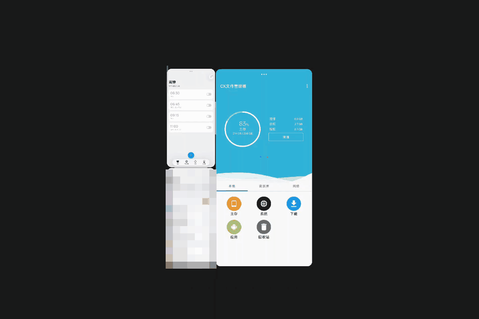

# 一加分屏增强

适配一加手机的 ColorOS 画布（Pocket Studio）增强 LSPosed 模块。可在同一个画布中使用最多四个应用。

## 项目来源与致谢

本项目在学习 [lehhair/CanvasPlus](https://github.com/lehhair/CanvasPlus) 的基础上修改，主要增加了 ColorOS 17 适配和手机横竖屏布局。感谢原作者 lehhair 和 CanvasPlus 的贡献者分享实现和技术文档。原项目提交历史和 Apache-2.0 许可随仓库保留。

## 功能与适配

- **双窗（ColorOS 17）**：默认上下排列，可在「⋯」菜单切换左右或上下布局。横屏双窗铺满画布。竖屏左右布局下，横拖两窗之间的淡蓝色分隔条调宽，拖任一窗口的底边可单独调整该窗口的高度。竖屏上下布局下，各窗口可独立在「⋯」菜单切换宽窄预设。
- **拖动调节大小（ColorOS 17）**：可调节的窗格间会显示蓝色分隔条。拖动分隔条时，应用随窗格重新排版。
- **锁定布局与尺寸记忆（ColorOS 17）**：在「⋯」菜单中锁定或解锁布局。横竖屏分别保存版式和主屏位置，比例按版式和横竖屏保存。
- **横屏三窗**：左侧两个小窗沿用横屏四窗对应位置的尺寸、间距和应用缩放，右侧主窗占据剩余两列。点击小窗可换主窗，也可以拖动分隔条调宽。
- **竖屏三窗**：在「⋯」菜单切换左右或上下布局。上下布局上方是两个小窗，下方是大主窗。
- **四窗**：横屏默认等宽并排，可拖列之间的分隔处调整宽度。竖屏固定为 2×2 等大网格。
- **竖屏**：三窗以右侧主窗和左侧两个小窗布局，四窗以 2×2 布局显示。
- **切换主屏位置**：打开双窗或三窗任意窗口的「⋯」菜单，在「自动切换主屏」下方点「主屏移到左边」或「主屏移到右边」，窗口会滑到新位置。横竖屏各自保存这个设置，重新打开画布也会保留。
- **B 站窗内全屏（8.60.0 普通视频页）**：在 LSPosed 为本模块勾选「哔哩哔哩」后重开 B 站，再点播放器的全屏键。视频在当前窗格中保持原比例，其他 App 留在画布中。
- **入口**：可通过智能侧边栏向当前画布添加应用，也可以用下方 ADB 命令打开多窗。
- **真机验证**：一加 15（PLK110），ColorOS 17.0.0.105，系统画布 2.0.0。不同系统或画布版本的兼容性可能不同。

## 真机演示

