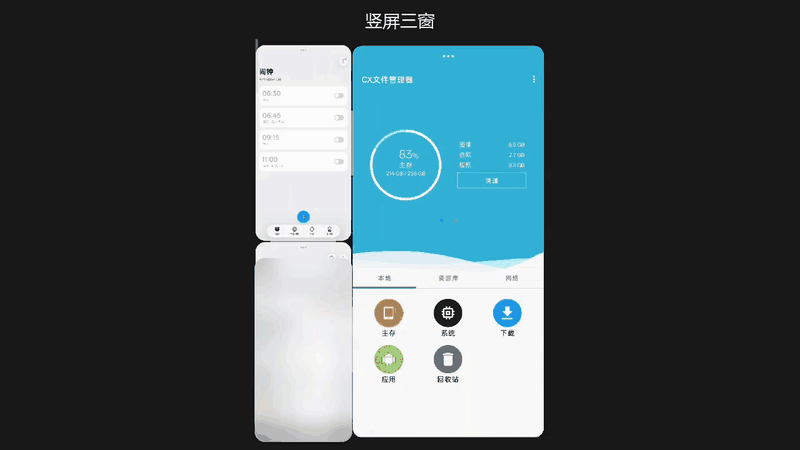

# 一加分屏增强

适配一加手机的 ColorOS 画布（Pocket Studio）增强 LSPosed 模块。可在同一个画布中使用最多四个应用。

## 项目来源与致谢

本项目在学习 [lehhair/CanvasPlus](https://github.com/lehhair/CanvasPlus) 的基础上修改，主要增加了 ColorOS 17 适配和手机横竖屏布局。感谢原作者 lehhair 和 CanvasPlus 的贡献者分享实现和技术文档。原项目提交历史和 Apache-2.0 许可随仓库保留。

## 功能与适配

- **横屏三窗**：左侧两个小窗沿用横屏四窗对应位置的尺寸、间距和应用缩放，右侧主窗占据剩余两列。点击小窗可换主窗，也可以拖动分隔条调宽。
- **横屏四窗**：四个竖长窗口从左到右等宽并排。
- **竖屏**：三窗以右侧主窗和左侧两个小窗布局，四窗以 2×2 布局显示。
- **入口**：可通过智能侧边栏向当前画布添加应用，也可以用下方 ADB 命令打开多窗。
- **真机验证**：一加 15（PLK110），ColorOS 17.0.0.105，系统画布 2.0.0。不同系统或画布版本的兼容性可能不同。

## 真机演示

一加 15 录屏，依次展示竖屏三窗、竖屏四窗、横屏四窗和横屏三窗。



## 下载与安装

1. 从 [GitHub Releases](https://github.com/vialoyed-ctrl/OnePlusSplitScreenEnhancer/releases/latest) 下载 APK 并安装。
2. 在 LSPosed 中启用「一加分屏增强」，勾选 **画布**（`com.oplus.pscanvas`）和 **智能侧边栏**（`com.coloros.smartsidebar`）。
3. 重启手机，让画布和侧边栏重新加载模块。

发布版包名为 `com.canvasplus`。旧版使用不同签名时，Android 会要求先卸载同包名旧版再安装。若手机上仍有之前独立安装的 ColorOS 17 测试模块，请在 LSPosed 中只启用其中一个模块。

## 构建

需要 Android SDK Platform 36、Build-Tools 36 和 JDK 17 或以上。

```bash
ANDROID_HOME=/path/to/sdk JAVA_HOME=/path/to/jdk bash build.sh
```

输出为 `dist/OnePlusSplitScreenEnhancer.apk`。构建脚本使用 Android 调试签名，可通过 `KEYSTORE` 指定本地密钥库。

## ADB 用法

先在手机上打开系统画布，再运行命令。按需换成手机上已安装的应用包名。

```bash
adb shell am broadcast -a com.canvasplus.START -p com.oplus.pscanvas \
  --esa packages com.tencent.mm,com.tencent.mobileqq,com.android.settings

adb shell am broadcast -a com.canvasplus.ADD -p com.oplus.pscanvas \
  --es pkg com.coloros.calculator
```

查看模块日志：

```bash
adb shell su -c 'grep -i canvasplus /data/adb/lspd/log/verbose_*.log | tail -20'
```

需要紧急停用时，在 LSPosed 中关闭模块并重启。也可以用下方命令设置停用标记，再重启手机。

```bash
adb shell su -c 'touch /data/system/canvasplus-halt'
```

## 许可

[Apache-2.0](LICENSE)。
